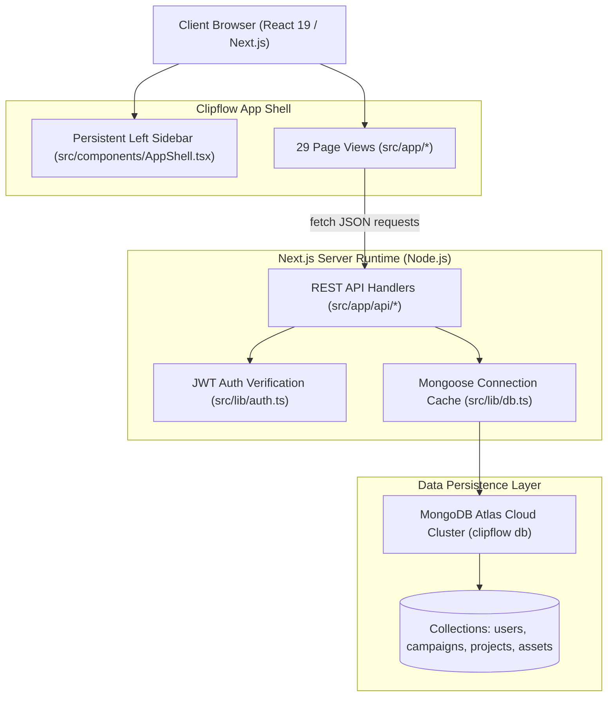
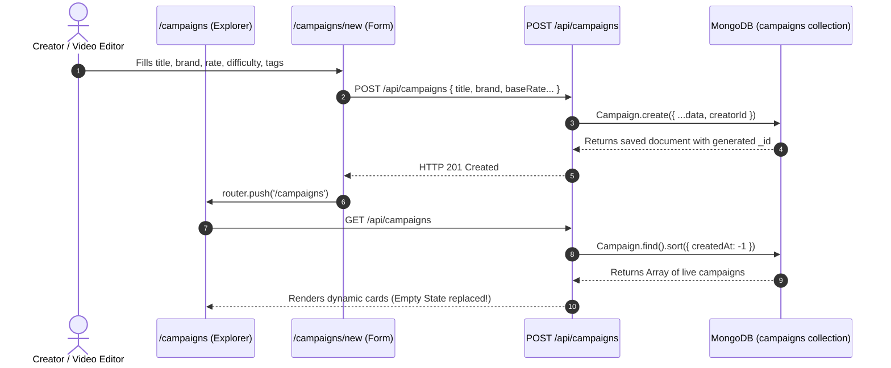

# CLIPFLOW MASTER DEVELOPMENT & ARCHITECTURE GUIDE
> **The Blueprint from Frontend Developer to ₹15 LPA Full-Stack & Agentic AI Engineer (Target: 2027)**  
> **Repository**: `CLIPFLOW Creator Studio`  
> **Author**: Technical Mentorship Team & Senior Software Architect  
> **Scope**: 100% Comprehensive Technical Breakdown (No Code Modified or Deleted)

---

## EXECUTIVE INTRODUCTION: YOUR JOURNEY TO ₹15+ LPA

As a frontend developer, you already possess visual intuition, component design sense, and user-experience awareness. However, the tech market in 2026-2027 does not reward superficial UI assembly or copy-pasting AI snippets without architectural comprehension.

To command a **₹15 LPA to ₹25 LPA salary** at top-tier product startups or engineering companies, interviewers evaluate you on four pillars:
1. **System Design & Architecture**: Can you design scalable, decoupled systems from client to database?
2. **Data Integrity & Backend Mastery**: Do you understand connection pooling, indexing, ACID constraints, validation, and session management?
3. **Debugging & Fundamental Understanding**: When something breaks (e.g., hydration mismatch, socket hang up, memory leak in background workers), can you trace it from source to destination without relying on AI guessing?
4. **Agentic AI & LLM Systems**: Can you distinguish between a gimmick chat bubble and a real agentic pipeline with Tool Calling, Remotion, FFmpeg, Whisper, and Retrieval-Augmented Generation (RAG)?

This master document is your single source of truth. It explains **every single file, dependency, concept, database query, API contract, and roadmap step** in Clipflow.

---

## 1. CURRENT PROJECT AUDIT

### 1.1 Complete Repository Structure Overview
```
CLIPFLOW/
├── .env                              # User Atlas connection string
├── .env.local                        # Active Next.js runtime environment variables
├── .gitignore                        # Git exclusion rules (node_modules, .next, .env*)
├── AGENTS.md                         # Auto-generated agent guidelines by Next.js
├── next.config.ts                    # Next.js bundler and compiler configuration
├── package.json                      # Dependency registry and runtime scripts
├── postcss.config.mjs                # PostCSS engine for Tailwind CSS processing
├── tailwind.config.ts / .js          # Theme design tokens, obsidian color palette
├── tsconfig.json                     # TypeScript compiler flags and path aliases (@/*)
├── docs/
│   ├── MISSION_AND_FEATURES.md       # Product vision and business requirement breakdown
│   ├── PROJECT_STATUS.md             # High-level progress tracker
│   └── CLIPFLOW_MASTER_DEVELOPMENT_GUIDE.md # (This Master Technical Blueprint)
└── src/
    ├── app/                          # Next.js 16 App Router Directory
    │   ├── globals.css               # Global CSS variables, reset, sleek studio scrollbars
    │   ├── layout.tsx                # Root layout, font injection, AppShell provider
    │   ├── page.tsx                  # Main Workstation Dashboard (/)
    │   ├── ai-assistant/page.tsx     # Hook & Viral Pacing Generator (/ai-assistant)
    │   ├── assets/                   # Asset Library & Vault (/assets)
    │   │   ├── page.tsx              # Vault listing & media categories
    │   │   ├── upload/page.tsx       # Media drag-and-drop stager (/assets/upload)
    │   │   └── [id]/page.tsx         # Asset deep inspector (/assets/[id])
    │   ├── calendar/page.tsx         # Submission cutoff schedule (/calendar)
    │   ├── campaigns/                # Campaigns & Bounties Module (/campaigns)
    │   │   ├── page.tsx              # Campaign directory & filter radar
    │   │   ├── new/page.tsx          # Custom campaign ingestion form (/campaigns/new)
    │   │   ├── saved/page.tsx        # Bookmarked bounties (/campaigns/saved)
    │   │   ├── sources/page.tsx      # Scraping & Ingest health monitor (/campaigns/sources)
    │   │   └── [id]/page.tsx         # Creative brief & dynamic payout calculator
    │   ├── channels/page.tsx         # YouTube / Instagram OAuth Gateway (/channels)
    │   ├── earnings/page.tsx         # Escrow balance & CPM ledger (/earnings)
    │   ├── forgot-password/page.tsx  # 100vh centered minimalist recovery (/forgot-password)
    │   ├── learning/                 # Creator Academy Module (/learning)
    │   │   ├── page.tsx              # Video editing masterclasses
    │   │   └── [id]/page.tsx         # Interactive video player & curriculum
    │   ├── login/page.tsx            # 100vh centered minimalist sign-in (/login)
    │   ├── projects/                 # Production Video Cuts Module (/projects)
    │   │   ├── page.tsx              # Kanban & list of active timeline cuts
    │   │   ├── new/page.tsx          # Provision new studio cut wizard (/projects/new)
    │   │   └── [id]/                 # Project deep workstation (/projects/[id])
    │   │       ├── page.tsx          # Timeline overview & guidelines
    │   │       ├── drafts/page.tsx   # Frame-accurate video review & change requests
    │   │       ├── plan/page.tsx     # AI Beat-sheet planner & hook stager
    │   │       └── tasks/page.tsx    # Audio mix & caption safe-zone task checklist
    │   ├── references/page.tsx       # Viral video breakdown library (/references)
    │   ├── register/page.tsx         # 100vh centered minimalist creator signup (/register)
    │   ├── settings/page.tsx         # Workstation preferences & profiles (/settings)
    │   ├── submissions/              # Client & Sponsor Review Tracker (/submissions)
    │   │   ├── page.tsx              # Submission queue & approval status
    │   │   └── [id]/page.tsx         # Timestamped revision logger (/submissions/[id])
    │   ├── toolkit/page.tsx          # 9:16 Aspect ratio crop & LUFS loudness calculator
    │   ├── trends/page.tsx           # Viral audio & hashtag breakout radar (/trends)
    │   └── api/                      # Backend Serverless Route Handlers
    │       ├── auth/
    │       │   ├── login/route.ts    # POST: Verify password & issue HTTP-only JWT
    │       │   ├── me/route.ts       # GET: Read session cookie & return profile
    │       │   └── register/route.ts # POST: Bcrypt hash password & create User
    │       ├── campaigns/route.ts    # GET: Fetch list | POST: Create campaign
    │       └── projects/route.ts     # GET: Fetch cuts | POST: Create project
    ├── components/
    │   ├── AppShell.tsx              # Unified persistent studio sidebar & mobile drawer
    │   └── AuthModal.tsx             # Legacy floating dialog component
    ├── lib/
    │   ├── auth.ts                   # JWT signing, verification, and cookie helpers
    │   └── db.ts                     # Mongoose connection pooling & caching
    └── models/                       # Mongoose Database Schemas
        ├── Asset.ts                  # Raw footage & stems metadata
        ├── Campaign.ts               # Brand briefs, payout rates & rules
        ├── ClipJob.ts                # Video rendering & clipping job queues
        ├── Project.ts                # Video projects & timeline stages
        ├── SocialAccount.ts          # Connected OAuth accounts
        └── User.ts                   # Creator profiles & password hashes
```

### 1.2 Audit Findings: What is Real vs What is Pending

| Layer | Component | Status | Reality Check / Verification |
| :--- | :--- | :---: | :--- |
| **Frontend UI** | 29 Screens | **100% Implemented & Verified** | All screens compile cleanly with Turbopack (`npm run build` exits with code 0). Styled in matte obsidian (`#09090b`), free of hardcoded mock data. |
| **Navigation** | `AppShell.tsx` | **100% Implemented & Verified** | Persistent Left Sidebar active across all screens; automatically excluded on Auth pages (`/login`, `/register`, `/forgot-password`). |
| **Database** | MongoDB Connection | **Configured & Verified** | `.env.local` configured with MongoDB Atlas Cloud URI (`cluster0.hflgh4u.mongodb.net/clipflow`). Tested via Node script with clean handshake. |
| **Auth APIs** | Login / Register / Me | **Implemented (Pending UI Wireup)** | Code exists in `src/app/api/auth/*` with Bcrypt & JWT. Currently, UI forms do not trigger active state update upon navigation. |
| **Campaign APIs**| `GET/POST /api/campaigns` | **Partially Implemented** | Route exists but `/campaigns/new` frontend does not dispatch `fetch('/api/campaigns')` to save into database. |
| **Project APIs** | `GET/POST /api/projects` | **Partially Implemented** | Route exists but `/projects/new` frontend does not dispatch `fetch('/api/projects')`. |
| **AI Generation**| `/ai-assistant` | **Frontend Mocked** | Uses client-side `setTimeout` simulation. No real Gemini/OpenAI API key hooked up yet. |
| **Video Engine** | FFmpeg / Whisper | **Not Started (Phase 3)** | Architecture planned; video processing is not yet installed in `node_modules`. |

---

## 2. TECHNOLOGY UNDERSTANDING: THE "WHY BEFORE HOW" DICTIONARY

Every serious engineer must be able to justify every single package in their `package.json`. Below is the complete dissection of Clipflow’s stack.

### 2.1 Next.js 16 (App Router & Turbopack)
- **What is it?** A production-grade React framework created by Vercel that combines client-side interactivity with server-side rendering (SSR), API routes, and optimized file-system routing.
- **Why are we using it?** Instead of building two separate repositories (a Vite/React frontend and an Express.js backend), Next.js gives us a unified full-stack codebase.
- **What problem does it solve?** Eliminates CORS (Cross-Origin Resource Sharing) headaches between frontend and backend during local development, provides instant SEO through Server Components, and bundles code with Turbopack in sub-second speeds.
- **Where is it used in Clipflow?** The entire `src/app` directory. Every folder represents a URL route, and every `route.ts` represents a REST API endpoint.
- **What happens if we remove it?** You would have to rebuild the project using React + React Router for the client, and a separate Express/Fastify server on another port (e.g. 5000), managing manual Webpack/Vite builds and CORS middleware.
- **Is it mandatory?** Yes. It is the spine of Clipflow.
- **Concepts to master first**: Server Components vs Client Components (`'use client'`), file-based routing (`page.tsx`, `layout.tsx`, `route.ts`), dynamic route segments (`[id]`).

### 2.2 React 19 & React-DOM 19
- **What is it?** The latest version of the industry-standard UI library based on declarative components, virtual DOM reconciliation, and hooks.
- **Why are we using it?** High-density interfaces like DaVinci Resolve or Clipflow need dynamic re-rendering of cards, calculators, tabs, and filters without reloading the page.
- **What problem does it solve?** Direct imperative DOM manipulation (`document.getElementById()`, `innerHTML`) is slow, error-prone, and impossible to scale across 29 screens.
- **Where is it used?** In all 29 pages and UI components (`useState`, `useMemo`, `useEffect`).
- **What concepts to master**: Component lifecycle, props, state immutability, closure traps in `useEffect`, and synthetic events.

### 2.3 TypeScript 5.7
- **What is it?** A strongly typed superset of JavaScript that compiles down to plain JavaScript.
- **Why are we using it?** In video editing and escrow workflows, confusing a `string` with a `number` (e.g. payout `"150"` vs `150`) can break financial calculations. TypeScript catches these bugs at compile-time before your code ever runs in production.
- **Where is it used?** Everywhere (`.ts` and `.tsx` files), especially data interfaces (`CampaignItem`, `ProjectSummary`, `IUser`).
- **Interview Question**: *"What is the difference between an `interface` and a `type` in TypeScript, and which should you use for database models?"* (Answer: Interfaces are extendable and ideal for object shapes and Mongoose document definitions; types are better for unions, primitives, and complex tuples).

### 2.4 Tailwind CSS & PostCSS
- **What is it?** A utility-first CSS framework that compiles on-demand classes directly into your stylesheet.
- **Why are we using it?** Traditional CSS leads to massive 10,000-line global stylesheets with naming collisions. Tailwind allows us to build pro matte dark interfaces directly in JSX using unified design tokens (`bg-[#09090b]`, `border-white/[0.08]`).
- **Where is it used?** All styling across all JSX elements, configured via `tailwind.config.ts`.
- **Helpers (`clsx` & `tailwind-merge`)**: Used to conditionally merge class names without conflict (e.g. `twMerge('px-2 py-1', isActive && 'bg-indigo-600')`).

### 2.5 Mongoose 8.9 & MongoDB
- **What is it?** MongoDB is a document-oriented NoSQL database that stores data in JSON-like structures (BSON). Mongoose is an Object Data Modeling (ODM) library that provides a strict schema, validation, and query API on top of MongoDB.
- **Why are we using it?** Video campaign briefs have flexible schemas (some campaigns have view-based bonuses, some have fixed bounties; some have asset links, some have tags). MongoDB handles dynamic JSON structures effortlessly.
- **Where is it used?** `src/lib/db.ts` (connection pool) and `src/models/*.ts` (`User`, `Campaign`, `Project`, etc.).
- **What happens if we remove it?** The app cannot remember anything. When you refresh the browser or restart the server, all created campaigns and projects disappear.

### 2.6 BcryptJS & JSONWebToken (JWT)
- **What are they?**
  - `bcryptjs`: A cryptographic hashing library based on the Blowfish cipher that incorporates automated salting and work factors to prevent rainbow table and brute-force attacks.
  - `jsonwebtoken`: An open standard (RFC 7519) that securely transmits user identity claims as a signed JSON object.
- **Why are we using them?**
  - **Never store passwords in plain text!** If a database is leaked, hackers instantly read everyone's password. Bcrypt hashes passwords so they cannot be reversed.
  - JWT allows our server to issue a tamper-proof session ticket stored in an `httpOnly` cookie.
- **Where are they used?** `src/app/api/auth/register`, `src/app/api/auth/login`, and `src/lib/auth.ts`.

### 2.7 Lucide React
- **What is it?** A clean, lightweight, highly customizable SVG icon library.
- **Why are we using it?** Professional video editing software relies heavily on visual iconography (film reels, waveform layers, shears, folders, checkmarks). Lucide provides crisp icons that render as pure SVG without heavy image asset requests.

---

## 3. END-TO-END APPLICATION ARCHITECTURE

The following sequence and architecture diagrams illustrate how Clipflow operates from the user's browser down to the database and back.

### 3.1 High-Level Architecture Diagram


### 3.2 Complete User Authentication Flow
```mermaid
sequenceDiagram
    autonumber
    actor User as Creator
    participant UI as /login (Page)
    participant API as POST /api/auth/login
    participant DB as MongoDB Atlas (users)
    participant Cookie as Browser Cookie Store

    User->>UI: Enters email & password
    UI->>API: HTTP POST { email, password }
    API->>DB: User.findOne({ email: email.toLowerCase() })
    DB-->>API: Returns user document with passwordHash
    API->>API: bcrypt.compare(password, passwordHash)
    alt Passwords Match
        API->>API: signSessionToken({ userId, email, displayName })
        API-->>Cookie: Set-Cookie: clipflow_session=<JWT>; HttpOnly; SameSite=Lax; Max-Age=7d
        API-->>UI: HTTP 200 { data: { id, email, displayName } }
        UI->>UI: router.push('/') -> Redirects to Dashboard
    else Invalid Password or User Not Found
        API-->>UI: HTTP 401 { error: "Invalid email or password" }
        UI->>UI: Displays error banner to user
    end
```

### 3.3 Dynamic Campaign & Project Lifecycle Flow


---

## 4. FEATURE-BY-FEATURE TECHNICAL DOCUMENTATION

Below is the exhaustive specification of all primary modules in Clipflow.

### 4.1 Module: Authentication & Session Gateways
- **Routes**: `/login`, `/register`, `/forgot-password`
- **Business Purpose**: Allows video creators to secure their workspace, manage projects privately, and ensure their earnings/escrow ledger is tied to their verified identity.
- **Frontend File Locations**:
  - `src/app/login/page.tsx`
  - `src/app/register/page.tsx`
  - `src/app/forgot-password/page.tsx`
- **Backend API Routes**:
  - `src/app/api/auth/register/route.ts`
  - `src/app/api/auth/login/route.ts`
  - `src/app/api/auth/me/route.ts`
- **Database Model**: `src/models/User.ts` (`email`, `passwordHash`, `displayName`, `role`, `timeZone`).
- **Security Protocols**:
  - Passwords salted with cost factor 10 using `bcrypt.genSalt(10)`.
  - Session cookie stored as `HttpOnly` (inaccessible to JavaScript `document.cookie`, preventing Cross-Site Scripting [XSS] token theft).
  - `SameSite=Lax` cookie attribute prevents Cross-Site Request Forgery (CSRF).

### 4.2 Module: Campaign Explorer & Bounty Ingestion
- **Routes**: `/campaigns`, `/campaigns/[id]`, `/campaigns/new`, `/campaigns/saved`, `/campaigns/sources`
- **Business Purpose**: Replaces messy Discord/Twitter DM bounty hunting with a verified marketplace of short-form video briefs offering fixed rates or CPM bonuses.
- **Frontend Implementation**:
  - Dynamic search filtering by brand, keyword, and category (`Tech & AI`, `Fintech`, `Gaming`, `Lifestyle`).
  - Deep brief inspector (`/campaigns/[id]`) featuring an interactive **Yield Projection Calculator** where creators adjust projected views to calculate potential bonus earnings.
- **Backend API**: `src/app/api/campaigns/route.ts`
  - `GET`: Returns active campaigns filtered by status.
  - `POST`: Validates and saves new brand brief documents.
- **Database Model**: `src/models/Campaign.ts`
  - Key Fields: `title`, `brand`, `category`, `source`, `payoutModel` (`fixed` | `cpm` | `hybrid`), `baseRate`, `ratePer1kViews`, `deadlineDate`, `aspectRatio`, `rules`, `mandatoryAssets`.

### 4.3 Module: Production Workstation (Projects Hub & Timeline Cuts)
- **Routes**: `/projects`, `/projects/new`, `/projects/[id]`, `/projects/[id]/plan`, `/projects/[id]/tasks`, `/projects/[id]/drafts`
- **Business Purpose**: Gives video editors a structured cut-staging pipeline (analogous to DaVinci Resolve’s Cut page or Frame.io’s review room) to manage raw stems, AI beat-sheet plans, task checklists, and client revision logs.
- **Frontend Implementation**:
  - Filter cuts by status: `Draft`, `Review`, `Approved`, `Rejected`.
  - Sub-navigation within a cut:
    - `/plan`: Segments a 60-second video into the 4 viral storytelling beats (0-3s Hook, 3-15s Retain, 15-45s Body, 45-60s CTA).
    - `/tasks`: Checklist for audio mixing, dynamic subtitles, and safe zones.
    - `/drafts`: Video preview player with frame-accurate timestamp annotations.
- **Backend API**: `src/app/api/projects/route.ts`
- **Database Model**: `src/models/Project.ts`
  - Fields: `title`, `campaignId`, `creatorId`, `aspectRatio` (`9:16`, `1:1`, `16:9`), `targetDuration`, `frameRate`, `status`, `timelineDrafts`.

### 4.4 Module: Asset Vault & Stem Staging
- **Routes**: `/assets`, `/assets/upload`, `/assets/[id]`
- **Business Purpose**: Centralized media vault for 4K B-Roll, sound effect libraries, fonts, and uncompressed `.wav` audio stems.
- **Database Model**: `src/models/Asset.ts`
  - Fields: `name`, `type` (`video`, `audio`, `image`, `document`), `fileUrl`, `fileSize`, `mimeType`, `projectId`, `tags`.

### 4.5 Module: Creator Academy & Intelligence
- **Routes**: `/learning`, `/learning/[id]`, `/trends`, `/references`, `/toolkit`, `/ai-assistant`
- **Business Purpose**: Equips creators with domain intelligence:
  - `/trends`: Velocity radar tracking viral sounds (+310% breakout) across TikTok, Reels, and Shorts.
  - `/references`: Breakdown of million-view viral videos with retention curve explanations.
  - `/toolkit`: 9:16 crop aspect ratio calculator and audio LUFS loudness normalizer.
  - `/ai-assistant`: Pattern-interrupt hook generator.

### 4.6 Module: Operations & Financials
- **Routes**: `/submissions`, `/submissions/[id]`, `/channels`, `/earnings`, `/calendar`, `/settings`
- **Business Purpose**: Tracks sponsor review status, OAuth social views for automated CPM verification, and escrow balances ready for Stripe withdrawal.
- **Database Model**: `src/models/SocialAccount.ts` and `src/models/ClipJob.ts`.

---

## 5. DATABASE AND API DEEP DIVE (THE BACKEND CRASH COURSE)

For a frontend developer, backend concepts often seem abstract. Here is the clear mental model for how databases and APIs actually work.

### 5.1 MongoDB Explained from Scratch
- **What is MongoDB?** A database is just a program running on a server that stores structured files on a hard drive and answers search queries very quickly. Unlike SQL databases (which store data in rigid Excel-like tables), MongoDB stores data in **JSON documents** (technically binary JSON called BSON).
- **Cluster**: A cluster is a group of cloud servers running MongoDB. Your Atlas cluster (`cluster0.hflgh4u.mongodb.net`) is hosted on AWS/Google Cloud.
- **Database**: Inside your cluster, you have different databases. We named ours `clipflow`.
- **Collection**: Inside `clipflow`, data is grouped into collections. A collection is like a folder or an array of objects. We have:
  - `users` (holds user objects)
  - `campaigns` (holds campaign objects)
  - `projects` (holds video project objects)
- **Document**: A single object or record inside a collection (e.g. `{ _id: "6790...", email: "editor@clipflow.studio" }`).

### 5.2 Mongoose: The Bridge Between TypeScript and MongoDB
Without Mongoose, you could accidentally save `{ age: "banana" }` into a number field. Mongoose gives you:
1. **Schema**: The blueprint specifying field names, data types, and validation rules.
   ```ts
   const CampaignSchema = new Schema({
     title: { type: String, required: true, trim: true },
     baseRate: { type: Number, required: true, min: 0 }
   });
   ```
2. **Model**: A compiled JavaScript class based on the schema that gives you query methods like `Campaign.find()`, `Campaign.create()`, `Campaign.findByIdAndUpdate()`, and `Campaign.deleteOne()`.

### 5.3 Connection Pooling (`src/lib/db.ts`)
Why can’t we just call `mongoose.connect()` inside every API file?
- Next.js API routes run as **serverless functions**. Every time a user clicks a button, a new function can spin up.
- If you call `mongoose.connect()` every time, your app will open 500 connections to MongoDB Atlas, hit the connection limit, and crash!
- **Solution**: We created a global cache in `src/lib/db.ts` that reuses the existing database connection across all requests.

### 5.4 How a REST API Request Works
When your React frontend calls `fetch('/api/campaigns', { method: 'POST', body: ... })`:
1. **Request Object**: The server receives an incoming HTTP packet containing headers, cookies, and a JSON body.
2. **Parsing**: `await req.json()` converts the incoming raw stream into a typed JavaScript object.
3. **Validation**: The backend checks: Are required fields missing? Is the user authenticated?
4. **Database Operation**: Mongoose writes the document to MongoDB Atlas.
5. **Response Object**: The backend returns `NextResponse.json({ success: true, data }, { status: 201 })`.

---

## 6. DEVELOPMENT STATUS TRACKER

| Module | Feature | Purpose | Technology | Current Status | Pending Work | Learning Required | Priority |
| :--- | :--- | :--- | :--- | :---: | :--- | :--- | :---: |
| **Theme & UI** | Obsidian Pro Studio | Eliminate neon AI template clutter | Tailwind CSS | **Completed & Verified** | None | CSS Design tokens | P0 |
| **Navigation** | Unified Sidebar | Single persistent workstation sidebar | `AppShell.tsx` | **Completed & Verified** | None | React Component composition | P0 |
| **Auth UI** | Centered 100vh Cards | Clean, distraction-free sign-in | React / Tailwind | **Completed & Verified** | None | Flexbox / Viewport constraints | P0 |
| **Database** | MongoDB Atlas Cloud | Cloud persistence for data | MongoDB Atlas | **Completed & Verified** | None | Connection strings & IP Access | P0 |
| **Auth Backend**| Register & Login API | Bcrypt password hashing & JWT cookies | Next.js API / JWT | **Implemented but unverified** | Wire up frontend submit to API | HTTP-only Cookies & JWT | P0 |
| **Campaigns** | Ingest & Create | Allow creators to add brand briefs | Mongoose / Form | **Partially completed** | Connect `/campaigns/new` to DB | REST API `fetch` & `revalidate` | P0 |
| **Projects** | Timeline Provisioner | Create and list active cuts | Mongoose / Form | **Partially completed** | Connect `/projects/new` to DB | Relational keys (`campaignId`) | P0 |
| **Assets** | Vault & Media Staging | Upload and inspect B-Roll | Mongoose / S3 | **Partially completed** | Connect cloud file storage (S3/UploadThing) | Multipart FormData & Blobs | P1 |
| **AI Hooks** | Viral Hook Generator | Generate pattern-interrupt scripts | Gemini 1.5 Flash | **Partially completed** | Replace `setTimeout` with Gemini API | LLM Prompting & API keys | P1 |
| **Submissions**| Review & Change Logs | Log client revision requests | Mongoose | **Partially completed** | Connect review feedback to DB | State machines (`Draft->Review`) | P1 |
| **Channels** | Social Account Linking | Track views on YouTube/TikTok | OAuth 2.0 | **Not started** | Implement OAuth2 client credentials | OAuth Authorization Code flow | P2 |
| **Video Engine**| Automated Clipper | Cut 9:16 vertical video & captions| FFmpeg / Whisper | **Not started (Phase 3)** | Install FFmpeg wrapper & worker | Video stream processing | P2 |

---

## 7. REBUILD ROADMAP (STEP-BY-STEP DEPENDENCY PLAN)

If you ever need to rebuild this entire project from a blank terminal, follow this exact sequence.

### Phase 1: Foundation Setup
1. **Initialize Next.js 16**:
   ```bash
   npx create-next-app@latest clipflow --typescript --tailwind --eslint --app --turbopack
   ```
2. **Install Core Dependencies**:
   ```bash
   npm install mongoose bcryptjs jsonwebtoken lucide-react clsx tailwind-merge
   npm install -D @types/bcryptjs @types/jsonwebtoken
   ```
3. **Configure Tailwind Design Tokens**:
   - Update `tailwind.config.ts` to include `#09090b` (studio-bg), `#121215` (studio-card), and `#6366f1` (accent-indigo).
4. **Create Global Database Cache (`src/lib/db.ts`)**:
   - Write the connection caching logic to prevent serverless connection exhaustion.

### Phase 2: Authentication Engine
1. **Create User Schema (`src/models/User.ts`)**: Define email, passwordHash, displayName, and role.
2. **Build Token Signer (`src/lib/auth.ts`)**: Implement `signSessionToken` and `verifySessionToken`.
3. **Create API Handlers**:
   - `src/app/api/auth/register/route.ts`: Validate inputs, check existing user, hash with bcrypt, create user, return cookie.
   - `src/app/api/auth/login/route.ts`: Find user, compare bcrypt hash, issue cookie.
   - `src/app/api/auth/me/route.ts`: Read cookie and return user profile.
4. **Wire Frontend Login & Register**:
   - Connect `src/app/login/page.tsx` and `src/app/register/page.tsx` to call `fetch('/api/auth/login')`.

### Phase 3: Core Workstation & CRUD
1. **Create Campaign Schema & API**:
   - Build `src/models/Campaign.ts` and `src/app/api/campaigns/route.ts`.
2. **Connect Campaign UI**:
   - In `/campaigns/new`, send form state to `POST /api/campaigns`.
   - In `/campaigns`, replace empty state with live cards fetched via `GET /api/campaigns`.
3. **Create Project Schema & API**:
   - Link project cuts to campaigns using MongoDB `ObjectId` references.

---

## 8. FUTURE AGENTIC AI ROADMAP (THE ₹15+ LPA DIFFERENTIATOR)

In 2026-2027, companies do not pay high salaries for basic ChatGPT wrappers. They hire engineers who understand **Agentic Orchestration, Tool Calling, and Deterministic Fallbacks**.

### 8.1 The Difference: Wrapper vs Agent
- **Naive AI Wrapper (Low Value)**: User types a prompt → Server sends prompt to ChatGPT → ChatGPT returns text → UI prints text.
- **Agentic AI System (₹15+ LPA Value)**: The AI has **tools, memory, goals, and an evaluation loop**:
  ```
  [User provides YouTube video URL]
                  │
                  ▼
  [Clipflow AI Agent receives Goal: "Generate 3 Viral 9:16 Shorts"]
                  │
                  ▼
  [Agent Tool Call 1]: download_audio(url) -> extracts .wav stem
                  │
                  ▼
  [Agent Tool Call 2]: transcribe_speech(audio) -> runs Whisper timestamp model
                  │
                  ▼
  [Agent Thought Loop]: "Analyzing viral hook score between 00:45 and 01:22..."
                  │
                  ▼
  [Agent Tool Call 3]: crop_and_cut(video, start="00:45", end="01:22", aspect="9:16")
                  │
                  ▼
  [Agent Tool Call 4]: generate_captions(srt) -> renders kinetic text
                  │
                  ▼
  [Agent Quality Guardrail]: "Does this video violate safe zones or brand tone?"
       ├── Passed: Upload to Asset Vault & Notify Creator
       └── Failed: Re-adjust cut timestamps and retry
  ```

### 8.2 Recommended Agentic Tech Stack for Phase 3
1. **Google Gemini 1.5 Flash API**: 1-million token context window, free developer tier, native structured JSON outputs.
2. **OpenAI Whisper (Speech-to-Text)**: Word-level millisecond timestamps for subtitles.
3. **FFmpeg Engine**: Fast local clipping, re-framing, and volume normalization.
4. **Model Context Protocol (MCP)**: Industry-standard protocol to connect your database and tools safely to AI agents.

---

## 9. SAFE RESET, BACKUP & DISASTER RECOVERY PLAN

Before performing any large-scale changes or refactoring, follow this safety guide to avoid project corruption or data loss.

### 9.1 Files That Must NEVER Be Deleted
- `src/lib/db.ts` (Database connection pooling logic)
- `src/lib/auth.ts` (Security and JWT encryption verification)
- `src/models/*.ts` (Mongoose schema definitions)
- `src/components/AppShell.tsx` (Unified workspace layout)
- `.env.local` / `.env` (Database connection strings)
- `package.json` & `package-lock.json`

### 9.2 Git Version Control & Snapshot Strategy
Before starting backend wireup or modifying files, create a permanent Git checkpoint:
```bash
# 1. Check current status
git status

# 2. Stage all working frontend and documentation files
git add .

# 3. Commit with a definitive tag
git commit -m "feat: complete verified frontend workstation with unified sidebar and atlas connection"

# 4. Create an isolated safety branch for backend wireup
git branch backend-integration
git checkout backend-integration
```
*If anything ever breaks on the `backend-integration` branch, you can return to your clean, working frontend in one second by running `git checkout main`.*

### 9.3 Environment Variable Security
- Never push `.env` or `.env.local` to public GitHub repositories!
- Always verify that `.gitignore` contains:
  ```
  .env*.local
  .env
  node_modules/
  .next/
  ```

---

## 10. TECHNICAL INTERVIEW CHEAT SHEET (FOR 2027 ROLES)

When an interviewer asks you about Clipflow, use these architectural talking points:

1. **"Tell me about the architecture of Clipflow."**
   > *"Clipflow is a high-density vertical video operations suite built on Next.js 16 and React 19. I designed it to unify the fragmented creator lifecycle—from bounty discovery to cut staging and escrow settlement. Rather than relying on standard mock data, the frontend enforces strict production empty states that interact with serverless REST handlers backed by MongoDB Atlas with Mongoose connection caching."*

2. **"How do you handle authentication securely?"**
   > *"We avoid localStorage because it is vulnerable to XSS token exfiltration. Instead, passwords are encrypted using Bcrypt with 10 salt rounds, and the server issues a signed JWT payload transmitted via an HttpOnly, SameSite=Lax cookie valid for 7 days."*

3. **"How do you prevent connection exhaustion in serverless Next.js API routes?"**
   > *"Serverless functions instantiate on demand, which can exhaust database connections if every invocation connects independently. In `src/lib/db.ts`, I implemented a cached connection promise bound to the Node.js global object, ensuring that hot lambdas reuse existing connection sockets."*

4. **"What is the roadmap for AI in this platform?"**
   > *"We don't use AI for things ordinary relational logic can solve. Our roadmap introduces an autonomous pipeline using Google Gemini and Whisper where the agent is equipped with tool-calling capabilities to transcribe audio, detect viral hooks based on retention velocity models, and trigger FFmpeg commands to generate 9:16 cuts automatically."*

---
*End of Master Development Guide. Keep this document open as you wire up your database and APIs.*
