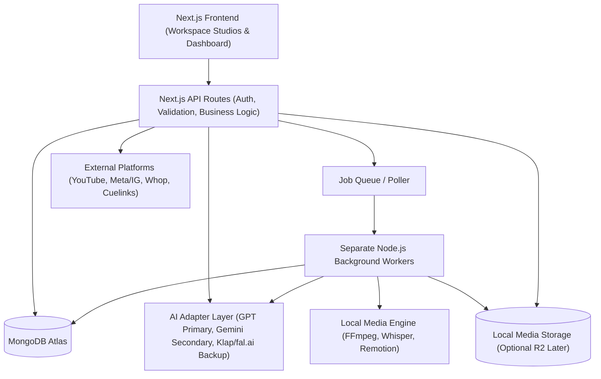

# CLIPFLOW MASTER PLAN (Single Source of Truth)

**Product:** Clipflow Creator Studio  
**Last Updated:** November 26, 2026  
**External Backup:** `../CLIPFLOW_DOCS_BACKUP/2026-11-26/` (18 legacy files preserved outside project)  
**Rule:** Only active master document. **Part A** records verified current codebase facts; **Part B** holds the new product & technical plan. Sections marked **Pending Discussion** will be finalized individually.

---

# PART A — Existing Project Information (Verified Codebase Baseline)

> **Inspected:** `src/` source code, `package.json`, `.env.local` (key names only), and automated checks on November 26, 2026.

## A.1 Existing Project Structure
```text
CLIPFLOW/
├── docs/CLIPFLOW_MASTER_PLAN.md      # Single active master plan
├── package.json                      # Dependencies & scripts
├── next.config.js                    # reactStrictMode: true
└── src/
    ├── proxy.ts                      # Next.js 16 edge proxy (cookie presence on 3 creation routes)
    ├── context/AuthContext.tsx       # Client session provider (/api/auth/me)
    ├── hooks/useDebounce.ts          # Debounce helper (250ms)
    ├── components/
    │   ├── AppShell.tsx              # Persistent studio sidebar (excluded on auth/welcome pages)
    │   └── AuthModal.tsx             # Unused legacy component
    ├── lib/
    │   ├── auth.ts                   # JWT sign/verify + cookie reader
    │   ├── db.ts                     # Cached Mongoose connection pool
    │   ├── rateLimit.ts              # In-memory IP rate limiter (15 req/60s)
    │   └── campaignAdapter.ts        # External campaign normalization & upsert
    ├── models/                       # 8 Mongoose schemas
    └── app/                          # 31 page routes + 24 API route files
```

## A.2 Existing Technology Stack (`package.json`)
- **Framework:** Next.js `^16.4.6` (App Router, Turbopack), React `^19.0.0`, TypeScript `^5.7.3`
- **Styling & Icons:** Tailwind CSS `^3.4.17`, `clsx`, `tailwind-merge`, `lucide-react` `^0.469.0`
- **Database & Validation:** MongoDB Atlas + Mongoose `^8.9.3`, Zod `^4.6.7`
- **Auth & Security:** `jsonwebtoken` `^9.0.3`, `bcryptjs` `^3.0.3`

## A.3 Implemented Features vs. Pending / Static Features
- **Implemented & Wired to MongoDB:**
  - **Auth Core:** `/login`, `/register`, `/forgot-password`, `/welcome` + `/api/auth/{register,login,logout,me,forgot-password,reset-password}`.
  - **Dashboard & Calendar:** `/` (`/api/dashboard`), `/calendar` (`/api/calendar`).
  - **Campaigns:** `/campaigns`, `/campaigns/[id]`, `/campaigns/new`, `/campaigns/saved`, `/campaigns/sources` + `/api/campaigns*`.
  - **Projects:** `/projects`, `/projects/new`, `/projects/[id]`, `/projects/[id]/{plan,tasks,drafts}` + `/api/projects*`.
  - **Assets (Metadata Only):** `/assets`, `/assets/upload`, `/assets/[id]` + `/api/assets*` (soft delete with 7-day TTL & restore).
  - **Operations:** `/submissions`, `/submissions/[id]`, `/earnings`, `/channels`, `/settings` + `/api/{submissions,earnings,channels,settings}*`.
- **Mock / Fallback / Metadata-Only:**
  - `/ai-assistant` (`POST /api/ai/hooks`): Currently returns **`mode: 'fallback'`**.
  - `/assets/upload` (`POST /api/assets`): Stores file metadata only (`objectKey` unused; **no binary upload/storage**).
- **Frontend-Only (Static UI, `hasFetch=False`):**
  - `/learning`, `/learning/[id]`, `/trends`, `/references`, `/toolkit`.
- **Schema-Only (No API/Worker/UI):**
  - `src/models/ClipJob.ts`.

## A.4 Existing Database Collections (8 Mongoose Models)
1. `User` (`users`): `email` (unique), `passwordHash`, `displayName`, `role`, `savedCampaignIds`, `resetCode`, `resetCodeExpiresAt`.
2. `Campaign` (`campaigns`): `title`, `brand`, `category`, `source`, `payoutModel`, `baseRate`, `availability`, `externalId`, `ownerId`.
3. `Project` (`projects`): `ownerId`, `campaignId`, `kind`, `status`, `conceptHook`, `scriptNotes`, embedded `tasks[]` & `drafts[]`.
4. `Asset` (`assets`): `ownerId`, `kind`, `category`, `externalUrl`, `objectKey`, `attachedProjectIds[]`, `deletedAt`, `expireAt` (TTL `0`).
5. `Submission` (`submissions`): `ownerId`, `projectId`, `campaignId`, `videoUrl`, `cutVersion`, `status`, `payoutAmount` (String).
6. `SocialAccount` (`socialaccounts`): `ownerId`, `platform`, `category`, `accountName`, `channelOrPageId`, `accessToken`, `stats` (no indexes).
7. `IngestSource` (`ingestsources`): `ownerId`, `name`, `provider`, `feedUrl`, `status`, `syncedCount`.
8. `ClipJob` (`clipjobs`): `ownerId`, `projectId`, `sourceUrl`, `status`, `detectedClips[]`, `targetAccounts[]` (no indexes; unused).

## A.5 Working APIs & External Integrations
- **YouTube Data API v3 (`YOUTUBE_API_KEY`):** **Live-verified (`200 OK`)** via `POST /api/channels/sync` on `@GoogleDevelopers` (public channel stats).
- **Google Gemini (`GEMINI_API_KEY`):** Configured in `.env.local` (`AQ...` format), currently rejected by Gemini REST API -> `/api/ai/hooks` runs in `fallback` mode.
- **Whop (`WHOP_API_KEY`):** Key saved in `.env.local`, **not yet wired** into `/api/campaigns/sources/sync`.
- **Not Configured / Not Implemented:** OpenAI GPT, Meta/Instagram Graph API, Cuelinks, FFmpeg, Whisper, Remotion.

## A.6 Security Issues & Technical Blockers
- **[P0 / TASK-P0-01] Project List & Detail IDOR (`src/app/api/projects/route.ts`, `[id]/route.ts`):** Code fix applied (`getCurrentUser()` before `connectDB()`, `401` verified live + build passed); 2-user DB isolation test blocked by Atlas IP access.
- **[P0 / TASK-P0-02] Unauthenticated Campaign Creation (`src/app/api/campaigns/route.ts:58-78`):** `POST` succeeds when `user` is `null`.
- **[P0 / TASK-P0-03] Submission Self-Approval & Duplicates (`src/app/api/submissions/[id]/route.ts`, `submissions/route.ts`):** Creators can `PATCH` `status: 'approved'` and submit duplicates.
- **[P0 / TASK-P0-04] Hardcoded Fallback JWT Secret (`src/lib/auth.ts:4`):** Literal fallback secret if `JWT_SECRET` is unset.
- **[P0 / TASK-P0-05] Unthrottled Password Reset (`forgot-password/route.ts`, `reset-password/route.ts`):** No `checkRateLimit()`, plaintext `resetCode`, no production email sender.
- **[P1] SSRF, ReDoS & Unprotected AI:** Unvalidated `feedUrl` fetch in `sources/sync/route.ts:45`; unescaped `$regex` search in `assets`, `campaigns`, `projects`; no auth/rate limit on `POST /api/ai/hooks`.
- **[P2] Minor Issues:** `GET /api/settings` does not exclude `resetCode`; `Campaign (source, externalId)` lacks `unique: true`; `.env.example` outdated (`NEXTAUTH_SECRET`).
- **Active Blockers:** (1) MongoDB Atlas `ReplicaSetNoPrimary` timeout; (2) `GEMINI_API_KEY` needs `AIza...` format; (3) `OPENAI_API_KEY` not configured.

## A.7 Verified Testing Results
- `npx tsc --noEmit`: **Passed (exit 0)**
- `npm run build`: **Passed (exit 0, Next.js 16.4.6 Turbopack, 33 routes)**
- `npm audit --omit=dev`: **Passed (0 vulnerabilities)**
- `npm run lint` (`next lint`): **Failed (exit 1 — `next lint` removed in Next.js 16)**
- Unit / Integration / E2E Test Suite: **Not configured**

---

# PART B — New Product and Technical Planning

| # | Section | Status |
| :--- | :--- | :--- |
| 1 | Product Requirements Document (PRD) | **Finalized** |
| 2 | High-Level Design (HLD) | **Proposed** |
| 3 | Technology Stack & Justification | **Pending Discussion** |
| 4 | Detailed Module Architecture | **Pending Discussion** |
| 5 | AI Integration Architecture | **Pending Discussion** |
| 6 | Media Processing Pipeline | **Pending Discussion** |
| 7 | Background Job Architecture | **Pending Discussion** |
| 8 | Database Design | **Pending Discussion** |
| 9 | API Design | **Pending Discussion** |
| 10 | Storage Architecture | **Pending Discussion** |
| 11 | Security Architecture | **Pending Discussion** |
| 12 | Cost Management | **Pending Discussion** |
| 13 | Deployment Architecture | **Pending Discussion** |
| 14 | Existing Project Gap Analysis | **Pending Discussion** |
| 15 | Implementation Planning | **Pending Discussion** |

---

## 1. Product Requirements Document (PRD)
**Status:** Finalized

### 1.1 Vision, Scope & Target
Clipflow is an **all-in-one AI-powered content creation, video editing, social media management, and earning platform**.

`Discover → Research → Recommend → Plan → Generate → Edit → Review → Publish → Analyze → Earn → Improve`

- **Initial Release:** Personal-use application managing 4–5 niche social accounts (Instagram & YouTube) and earning streams, built with **minimum additional expenses** and a **7-day target for the basic functional release**.
- **Workspace Homepage:** Begins with *"What do you want to create today?"* — Clipping, UGC, AI Video, Reference-to-Video, Editing, Discovery (Earning Opportunities), Trend Research, and Social Media Management.

### 1.2 Functional Requirements (`FR-01` to `FR-22`)
- **FR-01 Campaign Discovery:** Whop, Content Rewards, Cuelinks, affiliate/creator programs, manual URL/JSON entry, duplicate detection, daily sync, sync timestamps.
- **FR-02 Trend Research:** YouTube, Instagram, Google Trends, manual references, viral formats, hooks, hashtags, competitor comparison.
- **FR-03 AI Recommendation Engine:** **GPT primary**, **Gemini secondary**; campaign selection, niche/product ideas, hooks, scripts, durations, improvements.
- **FR-04 AI Clipping Studio:** Authorized YouTube/public URLs, livestreams, uploads; transcription, viral timestamps, multi-clip extraction, 9:16 crop, captions, music, SFX, HD MP4 export (local FFmpeg/Whisper first; Klap backup).
- **FR-05 AI UGC Studio:** Clothing, makeup, skincare, jewellery, accessories, gadgets ads from image/URL/description/reference; AI models, scripts, storyboards, voiceovers, lip-sync, assembly.
- **FR-06 AI Video Studio:** Text-to-video, image-to-video, reference-to-video, faceless/storytelling/educational/viral videos; **Google Flow, Veo, Adobe Firefly** preferred (manual asset import supported; fal.ai backup).
- **FR-07 Reference-to-Video Studio:** Analyze reference video/URL (structure, timing, style, camera, transitions, hooks, audio) -> generate original scene storyboard + per-scene regeneration.
- **FR-08 AI Scriptwriter:** Editable/reusable hooks, short-form/UGC scripts, voiceovers, scene descriptions, CTAs, captions, hashtags, SEO keywords, prompts.
- **FR-09 Storyboard & Scene Management:** Editable scenes (10s, 15s, 30s, 60s, custom) with duration validation, prompts, camera, character/product details, audio, transitions, add/delete/reorder/regenerate.
- **FR-10 Native Video Editing Studio:** Multi-track timeline (video, images, voiceover, music, SFX, captions, motion graphics, text), trim/split, smart crop, zoom/pan, speed, filters, transitions, undo/redo, auto-save, scene/full preview, HD MP4 export (**FFmpeg + Remotion**; Adobe Pro for advanced manual edits).
- **FR-11 Motion Graphics:** Automated & customizable animated text, kinetic typography, callouts, lower thirds, progress bars, logo/CTA/intro/outro animations (**Remotion**; After Effects optional).
- **FR-12 Voiceover & Audio Studio:** AI voiceovers, multi-language, speed/tone, per-scene narration, music, SFX, noise reduction, ducking, lip-sync; existing tools first, **ElevenLabs optional**.
- **FR-13 Subtitle & Caption Engine:** Word-level timestamps (**Local Whisper**), animated/word-by-word captions, styles, manual edit, SRT + burned-in export.
- **FR-14 Asset Management:** Reusable library (video, audio, AI assets/characters, products, fonts, logos, templates, references, exports) with folders, tags, search, brand isolation.
- **FR-15 Templates & Bulk Generation:** Reusable storyboards, edit/caption styles, AI characters, duplication, bulk variations within spending limits.
- **FR-16 Multi-Account & Brand Management:** Isolated brand workspaces (4–5 IG & YT accounts) with independent identity, connections, strategy, projects, assets, calendar, analytics, earnings, expenses.
- **FR-17 Publishing & Scheduling:** IG Reels & YT Shorts publishing (where authorized), AI captions/hashtags/covers, calendar, drafts, manual export fallback, mandatory user approval.
- **FR-18 Analytics:** Views, likes, comments, shares, engagement, followers, watch time, retention, top formats, GPT performance recommendations.
- **FR-19 Affiliate Management:** Discovery, products, affiliate/tracking links, product-to-content mapping, commissions, conversions, required ad disclosures.
- **FR-20 Earnings & Profit Tracking:** Submissions, approved vs pending earnings, affiliate commissions, received payouts, generation/subscription expenses, per-account/video/monthly net profit.
- **FR-21 AI Cost Management:** Estimated cost, credit usage, daily/monthly budgets, spending approval gates (no auto-purchase), provider/project/failed-job cost tracking.
- **FR-22 Notifications & Reliability:** Alerts for campaigns, deadlines, job status, failures, budget limits, approvals; queues, controlled retries, recovery, API health monitoring.

### 1.3 Approved Provider & Constraint Summary
- **Subscriptions First:** ChatGPT Pro, Gemini Pro, Adobe Pro.
- **AI & Creative:** GPT primary, Gemini secondary; Google Flow, Veo, Adobe Firefly preferred (manual import supported); fal.ai & Klap = backup; ElevenLabs = optional; **HeyGen & Creatify = removed**.
- **Video Output:** MP4, `9:16` (`1080×1920`) default + `16:9` / `1:1`, 720p–4K, embedded/SRT subtitles.

---

## 2. High-Level Design (HLD)
**Status:** Proposed

### 2.1 Architectural Style
**Modular Monolith + Local-First Hybrid Execution:**
- **Web App & API:** Next.js, React, TypeScript, Tailwind CSS.
- **Database:** MongoDB Atlas with Mongoose ODM.
- **Background Workers:** Separate Node.js worker process(es) for long-running media processing, AI pipelines, and scheduled syncs.
- **Storage:** Local media storage initially, with optional Cloudflare R2 later.

### 2.2 Logical Architecture


### 2.3 Hybrid Creative Workflow
When external creative subscriptions (Google Flow, Veo, Adobe Firefly, Adobe Pro) lack APIs: Clipflow generates the script/storyboard/prompts -> creator generates or refines assets externally -> imports assets into Clipflow's local storage -> FFmpeg/Whisper/Remotion handles assembly, captions, preview, and HD export.

---

## 3. Technology Stack & Justification
**Status:** Pending Discussion

## 4. Detailed Module Architecture
**Status:** Pending Discussion

## 5. AI Integration Architecture
**Status:** Pending Discussion

## 6. Media Processing Pipeline
**Status:** Pending Discussion

## 7. Background Job Architecture
**Status:** Pending Discussion

## 8. Database Design
**Status:** Pending Discussion

## 9. API Design
**Status:** Pending Discussion

## 10. Storage Architecture
**Status:** Pending Discussion

## 11. Security Architecture
**Status:** Pending Discussion

## 12. Cost Management
**Status:** Pending Discussion

## 13. Deployment Architecture
**Status:** Pending Discussion

## 14. Existing Project Gap Analysis
**Status:** Pending Discussion *(Baseline facts recorded in Part A; detailed reconciliation pending.)*

## 15. Implementation Planning
**Status:** Pending Discussion
